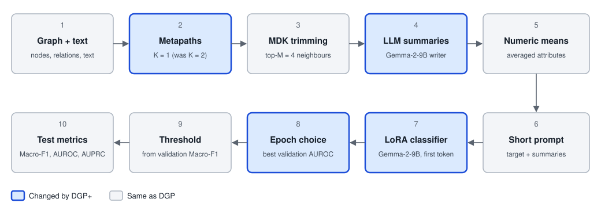

# DGP+

DGP+ detects fraud by combining a graph with a language model. It builds on DGP, the dual-granularity prompting method
from "DGP: A Dual-Granularity Prompting Framework for Fraud Detection with Graph-Enhanced LLMs" (AAAI 2026). This is an
independent implementation, not the DGP authors' code.

DGP+ makes three changes to DGP:

| Change | DGP | DGP+ |
|---|---|---|
| Metapath hops | K = 2 | K = 1, with K = 2 kept as a comparison |
| Summary writer and classifier | Qwen3-8B | Gemma-2-9B |
| Epoch selection | Lowest validation loss, patience 2 | Best validation AUROC, patience 3 |

Metapath trimming with the Markov diffusion kernel, top-M = 4, the numeric summary, the short prompt, LoRA, the first-token
Yes/No readout, the validation threshold, the splits and the seeds are unchanged.



## Results

Test set, mean ± population std over seeds 0-4. Epoch and threshold are chosen on validation data only.

| Dataset | Arm | Macro-F1 | AUROC | AUPRC | Mean prompt tokens |
|---|---|---:|---:|---:|---:|
| AmazonVideo | DGP reproduced | 65.16 ± 0.52 | 75.07 ± 0.50 | 32.33 ± 0.65 | 781.5 |
|  | DGP+ K = 1 | 65.05 ± 1.45 | 76.56 ± 0.25 | 34.01 ± 0.77 | 223.0 |
|  | DGP+ K = 2 | 64.86 ± 0.83 | 76.27 ± 0.37 | 34.31 ± 1.00 | 540.0 |
| YelpChi | DGP reproduced | 61.76 ± 1.86 | 78.38 ± 0.88 | 31.05 ± 1.31 | 792.1 |
|  | DGP+ K = 1 | 71.40 ± 0.64 | 85.30 ± 0.63 | 56.57 ± 1.49 | 268.1 |
|  | DGP+ K = 2 | 71.44 ± 0.19 | 85.55 ± 0.35 | 55.98 ± 0.99 | 543.2 |
| Instagram | DGP reproduced | 52.75 ± 2.10 | 58.27 ± 2.64 | 12.46 ± 1.08 | 135.0 |
|  | DGP+ K = 1 | 53.86 ± 0.87 | 58.86 ± 1.19 | 14.18 ± 1.26 | 70.5 |
|  | DGP+ K = 2 | 52.66 ± 2.59 | 60.20 ± 1.76 | 14.90 ± 1.48 | 90.3 |
| Reddit | DGP reproduced | 53.61 ± 1.01 | 62.26 ± 1.52 | 12.92 ± 0.81 | 254.8 |
|  | DGP+ K = 1 | 53.58 ± 3.20 | 65.37 ± 1.89 | 15.17 ± 1.23 | 213.8 |
|  | DGP+ K = 2 | 53.97 ± 1.08 | 65.01 ± 1.00 | 14.68 ± 0.68 | 233.4 |
| Amazon Instruments | DGP reproduced | 86.25 ± 1.01 | 97.02 ± 0.32 | 80.27 ± 1.74 | 1,113.8 |
|  | DGP+ K = 1 | 88.85 ± 1.01 | 97.67 ± 0.19 | 86.65 ± 1.09 | 628.6 |
|  | DGP+ K = 2 | 88.54 ± 1.30 | 97.74 ± 0.14 | 85.68 ± 1.42 | 838.9 |

### Comparison with DGP reproduced

Paired over 5 seeds. The CI is a paired bootstrap over test nodes, 2,000 rounds. Holm correction runs over all tests of one
dataset, including the K = 1 against K = 2 tests in [`docs/DGP_PLUS_RESULTS.md`](docs/DGP_PLUS_RESULTS.md).

| Dataset | Arm | Metric | Δ against DGP reproduced | 95% CI | Holm p | Survives Holm |
|---|---|---|---:|---|---:|---|
| AmazonVideo | K = 1 | Macro-F1 | -0.12 | [-0.74, +0.46] | 1.0000 | No |
|  | K = 1 | AUROC | +1.49 | [+0.75, +2.27] | 0.0078 | Yes |
|  | K = 1 | AUPRC | +1.68 | [+0.45, +2.92] | 0.0279 | Yes |
|  | K = 2 | Macro-F1 | -0.30 | [-0.95, +0.29] | 1.0000 | No |
|  | K = 2 | AUROC | +1.20 | [+0.48, +1.90] | 0.0058 | Yes |
|  | K = 2 | AUPRC | +1.98 | [+0.72, +3.22] | 0.0292 | Yes |
| YelpChi | K = 1 | Macro-F1 | +9.63 | [+8.45, +10.78] | 0.0025 | Yes |
|  | K = 1 | AUROC | +6.92 | [+6.10, +7.81] | 0.0018 | Yes |
|  | K = 1 | AUPRC | +25.53 | [+23.27, +27.74] | <0.0001 | Yes |
|  | K = 2 | Macro-F1 | +9.67 | [+8.47, +10.87] | 0.0025 | Yes |
|  | K = 2 | AUROC | +7.17 | [+6.35, +8.04] | 0.0003 | Yes |
|  | K = 2 | AUPRC | +24.93 | [+22.68, +27.15] | <0.0001 | Yes |
| Instagram | K = 1 | Macro-F1 | +1.11 | [+0.14, +2.06] | 1.0000 | No |
|  | K = 1 | AUROC | +0.58 | [-1.08, +2.25] | 1.0000 | No |
|  | K = 1 | AUPRC | +1.72 | [+0.60, +2.95] | 1.0000 | No |
|  | K = 2 | Macro-F1 | -0.09 | [-1.07, +0.87] | 1.0000 | No |
|  | K = 2 | AUROC | +1.93 | [+0.25, +3.58] | 1.0000 | No |
|  | K = 2 | AUPRC | +2.44 | [+1.29, +3.69] | 0.0781 | No |
| Reddit | K = 1 | Macro-F1 | -0.03 | [-0.86, +0.78] | 1.0000 | No |
|  | K = 1 | AUROC | +3.11 | [+1.78, +4.37] | 0.3451 | No |
|  | K = 1 | AUPRC | +2.25 | [+1.43, +3.07] | 0.3349 | No |
|  | K = 2 | Macro-F1 | +0.36 | [-0.41, +1.09] | 1.0000 | No |
|  | K = 2 | AUROC | +2.75 | [+1.51, +3.89] | 0.2173 | No |
|  | K = 2 | AUPRC | +1.76 | [+1.04, +2.48] | 0.3349 | No |
| Amazon Instruments | K = 1 | Macro-F1 | +2.60 | [+1.52, +3.67] | 0.0351 | Yes |
|  | K = 1 | AUROC | +0.65 | [+0.33, +0.96] | 0.0925 | No |
|  | K = 1 | AUPRC | +6.37 | [+4.32, +8.47] | 0.0220 | Yes |
|  | K = 2 | Macro-F1 | +2.29 | [+1.38, +3.30] | 0.0925 | No |
|  | K = 2 | AUROC | +0.72 | [+0.42, +1.02] | 0.0351 | Yes |
|  | K = 2 | AUPRC | +5.41 | [+3.32, +7.51] | 0.0532 | No |

Which gains survive Holm correction at 0.05:

- **YelpChi:** all three metrics, at both K = 1 and K = 2.
- **AmazonVideo:** AUROC and AUPRC, at both K values. Macro-F1 is flat.
- **Amazon Instruments:** Macro-F1 and AUPRC at K = 1, and AUROC at K = 2.
- **Instagram and Reddit:** none.

No K = 1 against K = 2 difference survives Holm on any dataset. K = 1 is the token-saving variant, and both are reported.

### Where the reference numbers come from

The DGP numbers are from a separate paper-recipe reproduction: Qwen3-8B writer and classifier, K = 2, lowest validation
loss, patience 2. That code is not in this repository, so these runs cannot be rerun from here. See
[`docs/RESULTS.md`](docs/RESULTS.md), which also gives the gap to the paper and the code parity checks.

FLAG numbers in `docs/RESULTS.md` are means over 7 GNN backbones. They are context only, not a head-to-head result.

### Compute

The 50 DGP+ runs took 113.27 GPU-hours on A100 80 GB GPUs, including failed attempts: 103.79 training, 6.58 metapath
summaries, 2.77 node summaries, 0.09 prompts and 0.05 trimming. Summaries already cached from earlier work are not
counted, so a full rerun from nothing would take longer.

## Datasets

DGP+ works on five datasets:

| Dataset | Nodes | Task | Built by `prepare_data.py` |
|---|---:|---|---|
| AmazonVideo | 37,126 | Fraud reviews | Yes |
| YelpChi | 67,395 | Fraud reviews | Yes |
| Instagram | 7,946 | Commercial users | No |
| Reddit | 18,389 | Popular users | No |
| Amazon Instruments | 11,944 | Fraud users | No |

The source datasets are not re-hosted, and each keeps its own terms. The Hugging Face mirror does hold derived files:
embeddings, trims and LLM summaries.

- **AmazonVideo:** the source URL and checksum are in `configs/datasets/amazonvideo.yaml`.
- **YelpChi:** this needs the original release with raw text, as `reviews.jsonl`, not `YelpChi.mat`.
- **Instagram and Reddit:** these come from [GLBench](https://github.com/NineAbyss/GLBench), whose packaging is MIT while
  upstream platform terms still apply. They are then downsampled 1:10 with a stratified 10/10/80 split, as in the benchmark
  of [FLAG](https://github.com/BUPT-GAMMA/FLAG).
- **Amazon Instruments:** this is FLAG's text-augmented version of the [CARE-GNN](https://github.com/YingtongDou/CARE-GNN)
  Amazon graph, with its splits and relations. The FLAG repository has no licence file, so check its terms first.

The last three are not built here. Place each in `data/processed/<name>/`:

```text
graph.json
labels.npy
numeric.npy
relation_<name>.npz    one file per relation
split.json
texts.jsonl
```

## Install

Python 3.12 is required. Tests run on CPU and download no models. Real runs need a GPU, and Gemma-2-9B is gated on Hugging
Face, so accept its terms and log in first.

```bash
pip install -e ".[dev]"
pytest
hf auth login
```

Tested with Python 3.12, torch 2.14.1, transformers 5.19.0, peft 0.21.2, numpy 2.5.4, scipy 1.18.1 and scikit-learn 1.9.1.

## Reproduce a table row

This reproduces the AmazonVideo K = 1 row and needs a GPU. Run one training job per GPU.

```bash
mkdir -p data/raw/amazonvideo
wget -P data/raw/amazonvideo https://snap.stanford.edu/data/amazon/productGraph/categoryFiles/reviews_Amazon_Instant_Video_5.json.gz
python scripts/prepare_data.py --config configs/runs/amazonvideo_k1.yaml
python scripts/run_queue.py configs/runs/amazonvideo_k1.yaml --gpus 0
python scripts/evaluate.py configs/runs/amazonvideo_k1.yaml
```

Every run writes its metrics, per-node predictions and a manifest to `runs/results/raw/`.

To rebuild the comparison, restore `baseline/` and `runs/` from the mirror, then run this on CPU. It takes about 30 minutes.

```bash
python scripts/compare_arms.py --baseline baseline/
```

## Limitations

1. **Untested combination.** Gemma-2-9B with the validation-AUROC epoch rule had not been run before this work. Earlier
   experiments showed a negative model-by-prompt interaction, so gains from separate changes need not add up.
2. **Weak statistics on some gains.** Several gains do not survive Holm correction, and five seeds give little power.
   Seed spread remains, for example ±3.20 Macro-F1 on Reddit at K = 1.
3. **Writer and classifier swapped together.** Gemma does both jobs, so the two effects cannot be separated here.
4. **K = 1 against K = 2.** Both are reported. K = 1 is the token-saving variant.
5. **Extension datasets are new ground.** Reddit, Instagram and Amazon Instruments use converted graphs, have no paper
   reference and no numeric summary, and the DGP+ changes were not tuned on them.
6. **Amazon Instruments.** A TF-IDF model alone reaches 92.7 AUROC and the labels come from CARE-GNN, so text may be a proxy
   for how the labels were made. 28% of targets are truncated to 1,024 tokens.
7. **Selection on validation.** Choosing the best of 10 epochs inflates validation scores. The test set is the judge.
8. **One fixed split per dataset.** Standard deviations reflect training seeds only.
9. **YelpChi source.** It comes from an unofficial mirror (67,395 reviews) and differs from FLAG's YelpChi (45,954 nodes).
10. **Mixed software stacks.** The stored reference runs and the new runs used different torch and CUDA builds.

## Future study

- Separate the writer and classifier: Qwen writer with Gemma classifier, and the reverse.
- More seeds on YelpChi.
- Per-dataset tuning of metapaths, top-M, learning rate and LoRA rank.
- User-node metapath designs for Reddit and Instagram.
- A camouflage robustness test.
- Late fusion with a GNN or MLP.
- GNN baselines (PMP, BWGNN) on the same splits.
- A standalone builder for Instagram, Reddit and Amazon Instruments.

## Backup and restore

The [Hugging Face mirror](https://huggingface.co/datasets/Manu2711/DGP-Plus) holds the code, caches, finished runs and a git
bundle with the full history. To restore the caches and runs into a clone:

```bash
hf download Manu2711/DGP-Plus --repo-type dataset --local-dir .
```

To restore the git history:

```bash
hf download Manu2711/DGP-Plus backup/dgp-plus.bundle --repo-type dataset --local-dir .
git clone backup/dgp-plus.bundle DGP-Plus
```

To make a new bundle:

```bash
git bundle create dgp-plus.bundle --all
git bundle verify dgp-plus.bundle
```

## Citation

Cite this repository and the DGP paper. See `CITATION.cff`.

## Licence

The code is MIT licensed; see `LICENSE`. Gemma-2-9B, Qwen3-8B, DeBERTaV3 and the datasets keep their own terms.
