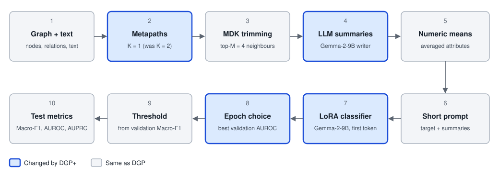

# Design

DGP+ builds on DGP (AAAI 2026). The DGP authors had not released code when this work was done, so this is an independent
implementation from the paper. Settings the paper does not state are marked `RECON` in `configs/base.yaml`; `GRID` marks
values chosen from the paper's search grid without a grid search.

## Pipeline

1. Load the graph, node text and numeric attributes.
2. List metapaths up to K hops.
3. Trim each metapath to the top M neighbours with the Markov diffusion kernel, over DeBERTaV3 and numeric features.
4. Write frozen LLM summaries for each node and metapath, with greedy decoding, so they can be cached.
5. Average numeric attributes along metapaths, where a dataset has them.
6. Build the short final prompt.
7. Train a LoRA classifier and read the Yes and No logits at the first generated token.
8. Keep the epoch chosen on validation data.
9. Pick the Macro-F1 threshold on validation data: 19 values from 0.05 to 0.95, predicting positive when p > t.
10. Score the test set once per kept epoch, after training ends.

## What DGP+ changes

| Stage | DGP | DGP+ | Where |
|---|---|---|---|
| Hops K | 2 | 1, with K = 2 kept as a comparison | `configs/runs/_k1.yaml` |
| Writer | Qwen3-8B | Gemma-2-9B, eager attention | `summarizer` in `configs/base.yaml` |
| Classifier | Qwen3-8B | Gemma-2-9B, eager attention | `classifier` in `configs/base.yaml` |
| Epoch rule | Lowest validation loss, patience 2 | Best validation AUROC, patience 3 (`auroc_es3`) | `training` in `configs/base.yaml` |

Each change is a config value. All 10 epochs run, and `loss_es2` and `auroc_all` are tracked on the same run for comparison.
Everything else follows DGP: MDK trimming, top-M = 4, metapaths, the numeric summary, the prompt, LoRA and the threshold.

## Code

| Module | Purpose |
|---|---|
| `dgp_plus/config.py` | YAML inheritance and run hashes |
| `dgp_plus/data.py`, `raw_data.py` | Graph and split formats, and builders for AmazonVideo and YelpChi |
| `dgp_plus/trimming.py` | Metapaths and MDK trimming |
| `dgp_plus/summarise.py`, `prompt.py`, `cache.py` | Summaries, prompt building and cached stores |
| `dgp_plus/pipeline.py` | Runs the stages from graph to prompts |
| `dgp_plus/classifier.py`, `train.py` | LoRA classifier, readout and epoch selection |
| `dgp_plus/evaluate.py`, `runs.py` | Metrics, statistics, and one run from start to finish |

## No test leakage

`train()` receives no test data. The epoch and threshold come from validation only, and test scores are computed after
training ends. Every run writes its config, git commit, seed, GPU, runtime, peak memory, prompt tokens and per-node
predictions.

## Known behaviour

- The writer tokenises with default special tokens. Changing this would change the text of every cached summary.
- Summary text shifts slightly with batch padding.
- Amazon Instruments joins all of a user's reviews, up to 321,281 tokens, so each source text is cut to its first 3,900
  tokens before summarising (`summarizer.max_source_tokens`).
- Eager attention needs memory in proportion to prompts x longest prompt squared, so `max_batch_tokens_sq` closes a batch
  early.
- Run one training job per GPU. Two Gemma runs on one GPU were much slower than one run alone.
